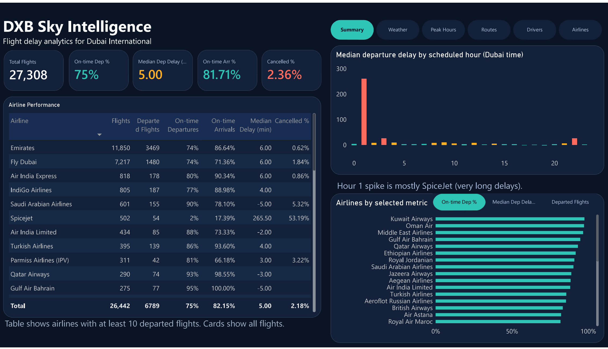
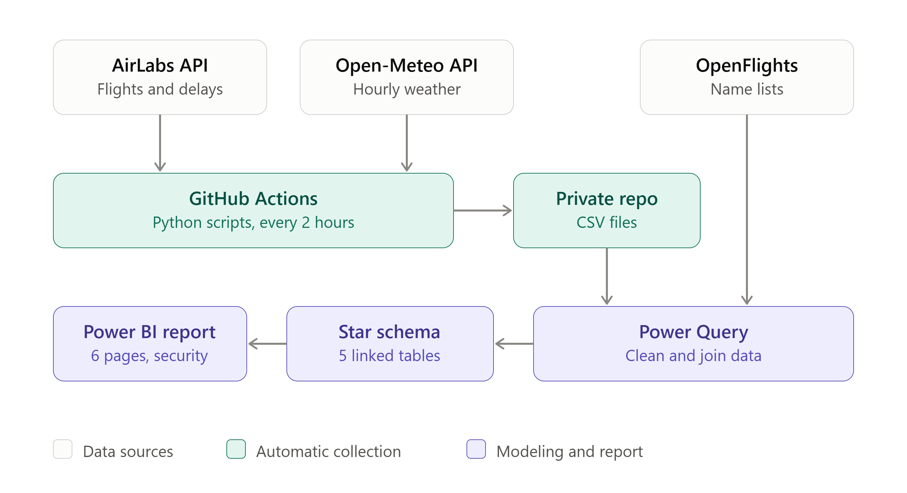
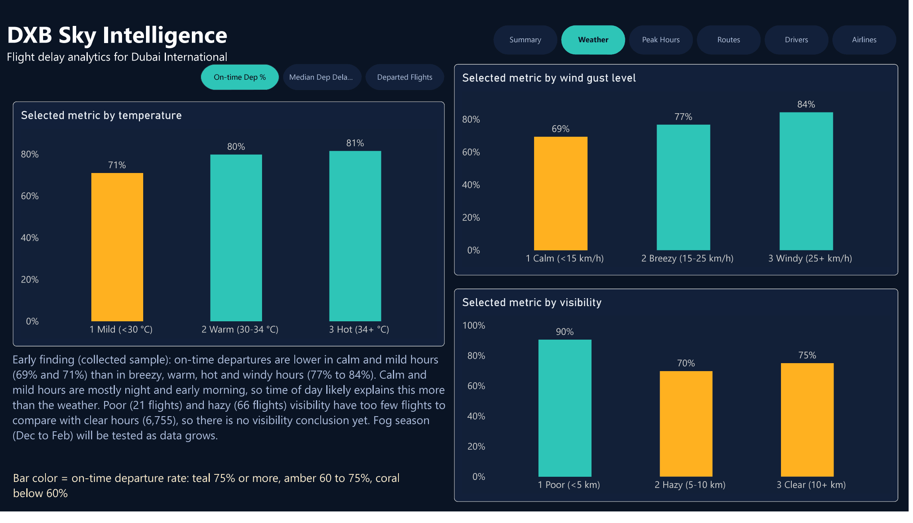
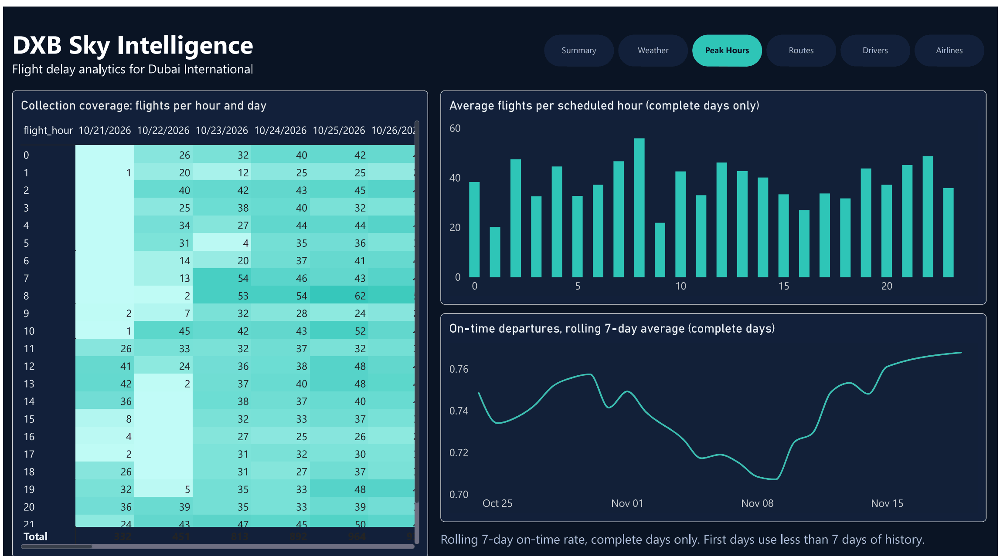
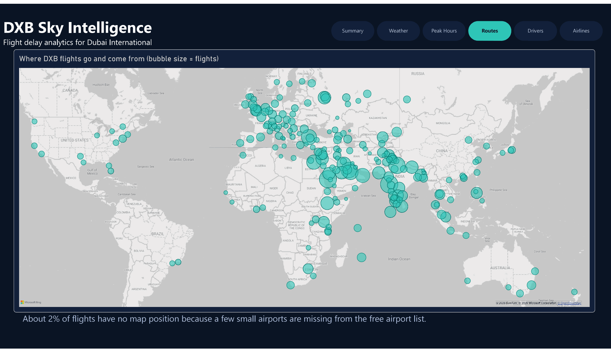
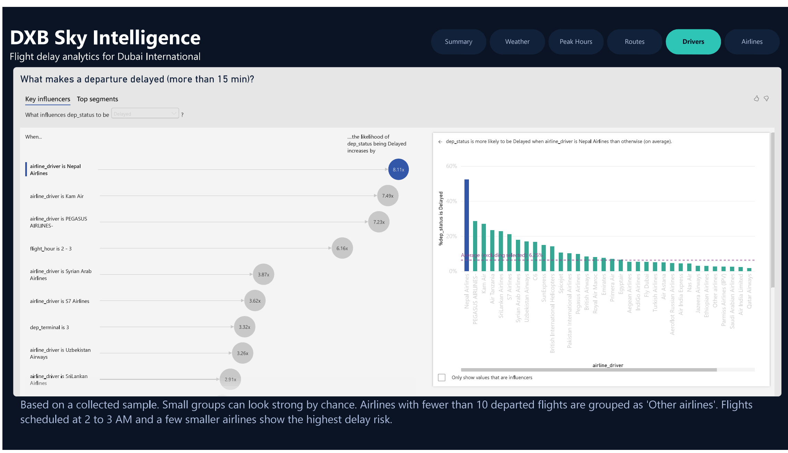
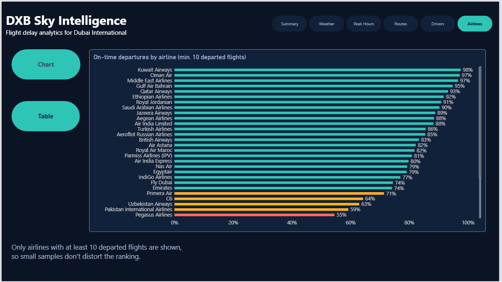
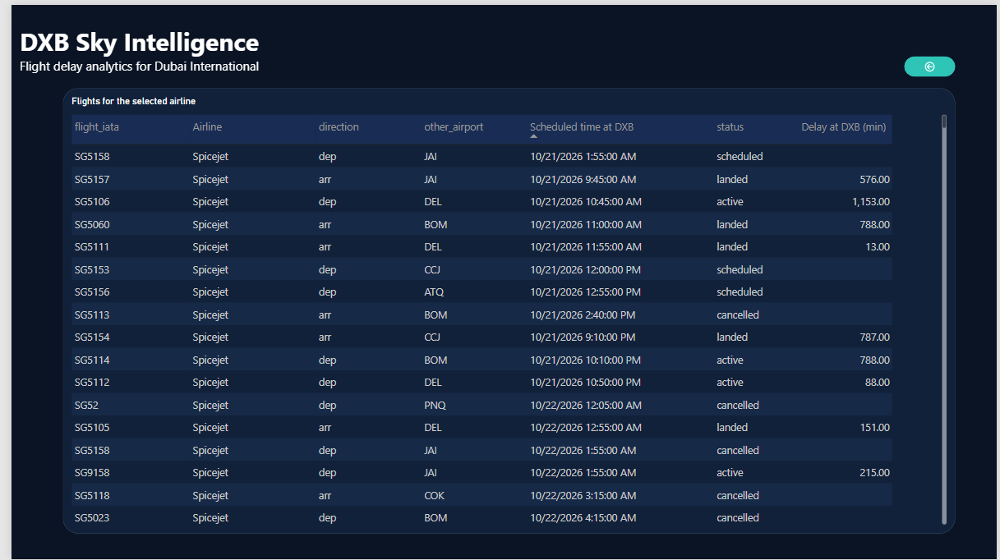

# DXB Sky Intelligence

Power BI report on flight delays at Dubai International (DXB), built on data I collected myself with an automated pipeline.

**Business question:** which airlines, hours, routes and weather conditions cause the most delays?

## Key numbers (collected sample, 21 Oct to 21 Nov 2026)
- 27,308 flights collected
- 75% on-time departures (15 minutes or less)
- 5 min median departure delay
- 81.71% on-time arrivals
- 2.36% cancelled

## How it works

- **Flights:** AirLabs Schedules API (free plan), collected every 2 hours by a GitHub Actions workflow. A cron-job.org timer triggers it, with a GitHub schedule as backup.
- **Weather:** Open-Meteo, one file per day.
- **Names and locations:** OpenFlights airline and airport lists.
- The raw data lives in a private repo, so it is not published here.

## Data model
- Star schema: `flights` (fact) linked to `dim_airline`, `dim_airport`, `dim_date` and `weather_hourly`.
- Power Query: combined the files, kept the latest record per flight, kept operating flights only (codeshares removed), and calculated my own delay columns from scheduled and actual times, because the API delay fields were unreliable.
- DAX: on-time departure and arrival %, median delay, cancelled %, weather bands, and a rolling 7-day on-time rate.
- Row-level security roles for Emirates and flydubai managers, tested with View as.
- Field parameter to switch the metric, bookmarks, drillthrough and a report-page tooltip.

## Findings
- Emirates and Fly Dubai both have about 74% on-time departures.
- Departures are less punctual in calm and mild hours (69% and 71%) than in breezy, warm, hot and windy hours (77% to 84%). Those hours are mostly at night, so time of day likely explains this better than the weather.
- Poor (21 flights) and hazy (66 flights) visibility have too few flights to conclude anything. Fog season (Dec to Feb) is not covered.
- The rolling 7-day on-time rate stays between about 70% and 77%.
- Key influencers points to flights at 2 to 3 AM and a few smaller airlines. These are small groups and can look strong by chance.
- SpiceJet shows 2% on-time. Its flights show daily delays of 13 to 19 hours, which likely come from outdated scheduled times in the free API, so I treat it as an outlier.

| Weather | Peak hours |
|---|---|
|  |  |
| **Routes** | **Drivers** |
|  |  |
| **Airlines** | **SpiceJet drillthrough** |
|  |  |

## Limits
- This is a collected sample, not full airport traffic. Some hours have gaps.
- Flight statuses can go stale (the API keeps the last recorded value).
- Delays are calculated by me, not taken from the API.
- About 2% of flights have no map position because a few small airports are missing from the free airport list.
- Airlines with fewer than 10 departed flights are hidden from rankings.

## Files
- [Report PDF](report/DXB-Sky-Intelligence.pdf)
- [Data dictionary](docs/data-dictionary.md)
- Video walkthrough: *(link to be added)*

## Tools
Power BI, Power Query, DAX, Python, GitHub Actions, cron-job.org, AirLabs API, Open-Meteo
